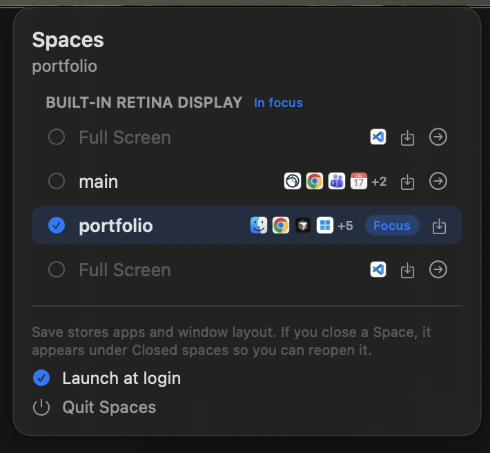

# Spaces

Menu bar app that names macOS desktop Spaces and shows the name of the Space on the display that currently has focus.

<p align="center">
  
</p>

<p align="center">
  
</p>

## Features

- The menu bar title is the custom name of the focused display's current Space (or `Desktop N` until you name it).
- Click the menu bar item to rename Spaces and to jump to one.
- Multiple displays are grouped by screen. Each screen's current Space is marked; the keyboard-focused one is labeled **Focus**.
- Names are stored by Space UUID, so they survive Mission Control reordering and reboots.
- Save a Space's apps and window layout (download icon), then restore it later (reload icon). If you close the desktop in Mission Control, it stays under **Closed spaces** so you can reopen it. Restore needs Accessibility permission so windows can be positioned and a new desktop can be created.
- Shows what happens to desktops when you unplug a display (see [Unplugging displays](#unplugging-displays)). Turn it off with **Track unplugged displays** in the menu.

## Unplugging displays

With **Displays have separate Spaces** on (System Settings → Desktop & Dock), macOS keeps the desktops of the display that has the menu bar. On every other display, the first desktop is the one that can be merged. This was checked on macOS 15.0.1.

- When a display without the menu bar goes away, its first desktop is removed and its windows are merged into the menu-bar display's first desktop. Its other desktops move intact to the menu-bar display and keep their names. It makes no difference whether the first desktop is empty or named.
- When the display with the menu bar goes away (unplugging an external display that has it, or closing the lid while the built-in display has it), all its desktops move intact to the display that takes over the menu bar. That display's own first desktop is merged instead.
- So with two displays, the merged desktop is always the first desktop of the display without the menu bar, whichever display goes away.
- When the display comes back, macOS recreates the merged desktop with the same identity, so its name returns. It moves back the windows you didn't close or move to another desktop, and it returns the other desktops.

The app doesn't move windows or desktops itself. It only shows what's going on:

- An orange merge icon marks a desktop that will be merged and has windows. Keep that desktop empty and nothing gets merged.
- A circled U-turn arrow marks desktops that are parked until their display returns.
- Merged desktops are listed under **Unplugged displays** until their display comes back.

To avoid merging completely, turn off **Displays have separate Spaces**. One set of desktops then spans all displays and they switch together, the menu bar appears only on the main display, and window tiling and Stage Manager stop working. The change needs a logout.

## Requirements

- macOS 14 or later
- Xcode Command Line Tools (`xcode-select --install`)

This uses private WindowServer APIs (`SkyLight`) to read and switch Spaces. Apple can change those APIs in a future macOS release.

## Build and run

```bash
./build.sh
open build/Spaces.app
```

The app is a menu bar extra (no Dock icon). Click the Space name in the menu bar to rename desktops or switch to one. Use the download icon to save that Space's apps and window positions, and the reload icon to bring them back. If you close the desktop in Mission Control, it stays listed under **Closed spaces** — Reopen creates a new desktop and launches the saved apps.

`./build.sh` installs `~/Applications/Spaces.app`. Restore needs Accessibility permission; after a rebuild, if macOS still prompts, remove the old Spaces entry and add this copy again. Enable **Launch at login** if you want the app to start on its own.
